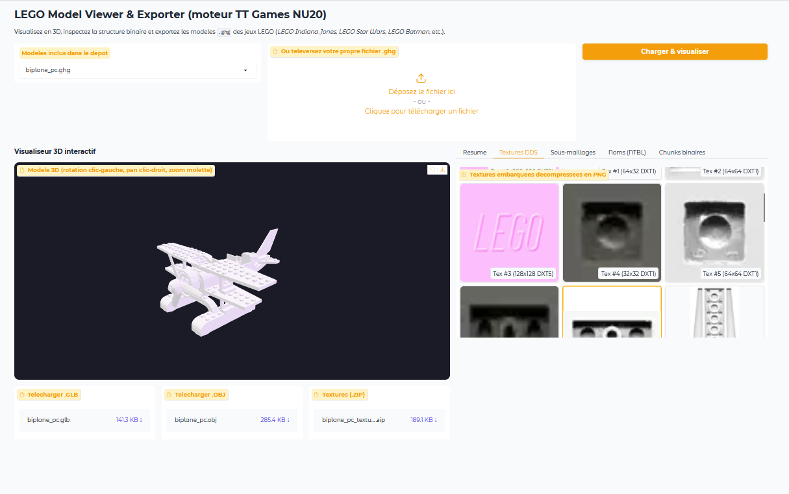

# LEGO GHG 3D Explorer & Exporter

Application interactive pour analyser, visualiser en 3D et exporter les modeles `.ghg` / `NU20`
des jeux LEGO developpes par TT Games (LEGO Indiana Jones, LEGO Star Wars, LEGO Batman, etc.).

## Apercu



*Visualisation du biplan, textures DDS extraites et exports disponibles.*

## Fonctionnalites

- Visualisation 3D WebGL via `gr.Model3D` (rotation, pan, zoom).
- Chargement des modeles inclus ou import d'un fichier `.ghg` / `.bin`.
- Extraction des textures DDS (DXT1/DXT5) en PNG et export ZIP.
- Export des maillages en `.glb` (glTF 2.0 binaire) et `.obj`.
- GLB textures : materiaux MS00, couleurs diffuses, UVs, alpha et images DDS integrees.
- Inspection des chunks binaires, des noms NTBL et des sous-maillages (draws).
- Reconstruction des sous-maillages a partir des enregistrements DISP et des vertex/index buffers.

## Installation

Le projet utilise [uv](https://docs.astral.sh/uv/) et Python 3.12+.

```bash
uv sync
uv run python app.py
```

L'interface est disponible sur `http://127.0.0.1:7860`.

Pour lancer l'application comme commande :

```bash
uv run ghg-explorer
```

## Tests

```bash
uv run python -m unittest discover -s tests -v
```

Les tests verifient les statistiques, les bornes, la coherence des normales, le mapping
materiau/texture et l'export GLB texture des trois echantillons du depot.

## Format NU20 / GHG (resume)

- Les chunks sont little-endian. Le champ `size` **inclut** l'en-tete de 8 octets :
  `offset_suivant = offset + size`.
- La chaine principale commence a `0x10` (le champ taille de `NU20` n'est pas un chunk standard).
- `DISP` est imbrique dans `CDAT`.
- La geometrie est stockee en fin de fichier :
  `[u16 nVB][(u32 byteSize, data) * nVB][u16 nIB=1][u32 ibBytes][u16 indices]`.
- Les sous-maillages sont decrits par des enregistrements de **56 octets** dans `DISP` :
  - `+0x04` : nombre d'indices
  - `+0x08` : stride (u16)
  - `+0x14` : offset dans le vertex buffer
  - `+0x18` : nombre de sommets
  - `+0x1C` : offset dans l'index buffer
  - `+0x24` : index du vertex buffer (0-based)
- Les indices de chaque draw sont **relatifs au `vbOffset`** du draw.
- Les faces sont des **triangle strips** : alternance du winding et suppression des degeneres.
- Le biplan contient deux copies identiques de son maillage dans le meme vertex buffer ; les faces
  dupliquees sont supprimees par comparaison des positions arrondies.
- `TST0` decrit les textures (largeur, hauteur, format DXT, taille des donnees).
- `MS00` contient les materiaux : identifiant, couleur diffuse RGBA et index de texture signe
  (`-1` = pas de texture).
- `GSNH` associe les layers aux os et aux parties, puis chaque partie a un materiau ; la table des
  materiaux est inversee pour retrouver l'ordre des draws.

## Limites connues

- Les transforms de bind du squelette GSNH sont appliquees (helice, roues, tete, bras).
  Les animations ne sont pas encore lues.
- Les variantes console big-endian (`_gc.ghg`, `_x360.ghg`, etc.) ne sont pas prises en charge.

## Structure

- `app.py` : interface Gradio, galerie de textures, tableaux de chunks/draws et exports.
- `ghg_parser.py` : parseur `GHGModel`, extraction des chunks, textures et geometrie.
- `tests/test_ghg_parser.py` : tests de non-regression sur les trois echantillons.
- `assets/` : images de demonstration utilisees par le README.
- `exports/` : sorties generees (ignorees par git).
- `instruct.md` : notes techniques detaillees sur le format et l'architecture.
